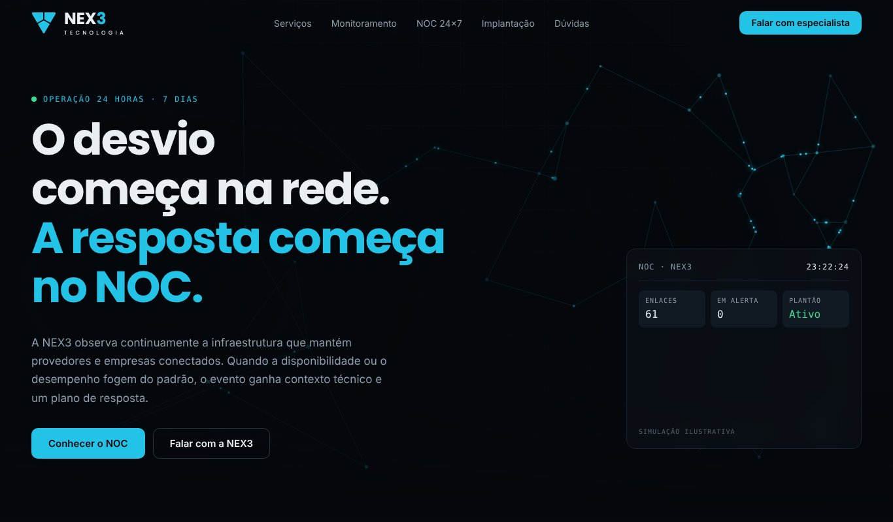
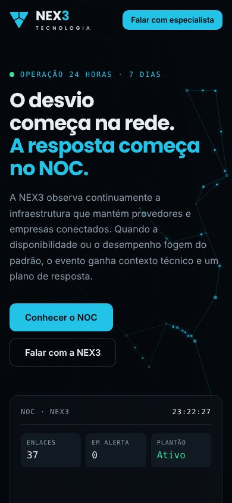

# NEX3 Tecnologia · site institucional

Site institucional da **NEX3 Tecnologia**, empresa de NOC 24x7, consultoria de redes e serviços gerenciados de TI para provedores e empresas.

**Prévia:** https://weversonfbr90.github.io/nex3-site/



## O que o site tem

- **Abertura animada:** uma rede de nós desenhada em `<canvas>` e um painel de NOC simulado, com relógio e indicadores ao vivo.
- **Seções** de serviços, cobertura de monitoramento, processo do NOC, implantação e perguntas frequentes.
- **Animações na rolagem** com `IntersectionObserver`: elementos aparecem e números contam conforme a página desce. A animação do canvas pausa quando ele sai da tela.
- **Formulário de contato** com validação, consentimento de privacidade e campo anti-robô.
- **Layout responsivo**, pensado também para o celular.



## Tecnologias

HTML, CSS e JavaScript puros, sem dependências nem etapa de build.

## Arquivos

- `index.html`, `estilo.css`, `app.js`
- `assets/nex3-simbolo.svg`: símbolo da logo em vetor
- `assets/favicon.svg`, `assets/apple-touch-icon.png`, `assets/og-image.png`

## Rodar localmente

```bash
python -m http.server 4175
# abra http://localhost:4175
```

O formulário só envia de verdade no servidor que tem o `/api/contato`.

## Publicar

Publicar os arquivos na raiz do mesmo servidor do site atual, mantendo:

- `POST /api/contato`: recebe JSON com `nome`, `email`, `empresa`, `assunto`, `mensagem`,
  `privacidade` ("on") e `website` (anti-robô, deve vir vazio). Em erro, pode responder `{ "erro": "mensagem" }`.
- `/privacidade`: página do Aviso de Privacidade (linkada no formulário e no rodapé).
